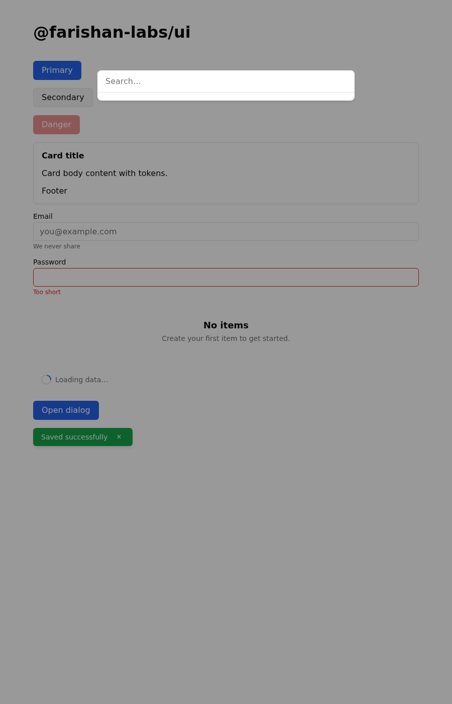

# @farishan-labs/ui

 

## Get the toolkit

[](https://www.npmjs.com/package/@farishan-labs/ui)
[](https://www.npmjs.com/package/@farishan-labs/ui)
[](https://farishan1.gumroad.com/l/sknrfm)

Part of Faris Han Labs. Buy the OpenCode Dev Toolkit on Gumroad.

Headless UI primitives + W3C DTCG tokens for Faris Han Labs. Web components
(first), a11y-first, framework-agnostic core. GPL-3.0.



## Status

v0.1 in progress. See `PHILOSOPHY.md` for the durable principles and
`AGENTS.md` for tooling.

## Install

```bash
bun add @farishan-labs/ui
# tokens ship with this package (design-tokens merged in)
```

Or drop in the generated CSS:

```html
<link rel="stylesheet" href="node_modules/@farishan-labs/ui/dist/tokens.css" />
```

## Usage

```ts
import "@farishan-labs/ui"; // registers custom elements
import { tokens } from "@farishan-labs/ui/tokens";
```

```html
<ui-button variant="primary">Save</ui-button>
```

## Architecture / Layers

FHL UI is organized into four layers (see `PHILOSOPHY.md` §1, §3):

1. **Behavior** — state, keyboard nav, focus, ARIA, events. Ships in the component.
   No CSS opinions. (`src/core/component.ts`, `src/components/*`)
2. **Tokens** — W3C DTCG JSON → generated CSS/TS constants. Single source of visual
   truth. (`src/tokens/*`)
3. **Presentation** — consumer's styling engine + token CSS variables. Not shipped.
4. **Adapters** — opt-in bridges to external engines (e.g. ui-sdk.dev) behind the
   FHL token/a11y contract. (`src/adapters/*`)

Accessibility (P2), agent-readable semantics (P3), and token-driven visuals (P4)
are non-negotiable across all layers. See `PHILOSOPHY.md` for the full rationale.

## Adapters (opt-in)

FHL UI's core stays self-contained and offline-capable. Remote/external UI SDKs
are integrated through opt-in adapters under `src/adapters/`, not the core:

```ts
import "@farishan-labs/ui/adapters/ui-sdk";
```

- `adapters/ui-sdk` — lazily loads the ui-sdk.dev component SDK and bridges FHL
  design tokens onto it. Rejects (and leaves core untouched) when the remote is
  unavailable, so consumers can fall back to FHL primitives / native elements.

## Development

```bash
bun install
bun run check
bun test
```

## Research basis

`research/topics/farishan-labs-ui/` (README, findings E0001–E0080, gaps G1–G31,
needs N1–N11). Research gate satisfied 2026-11-09.

## Installation

```bash
npm install @farishan-labs/ui
```

---

## Support

If this is useful, a star on GitHub helps. Paid tier (OpenCode Dev Toolkit) on Gumroad: https://farishan1.gumroad.com/l/sknrfm
