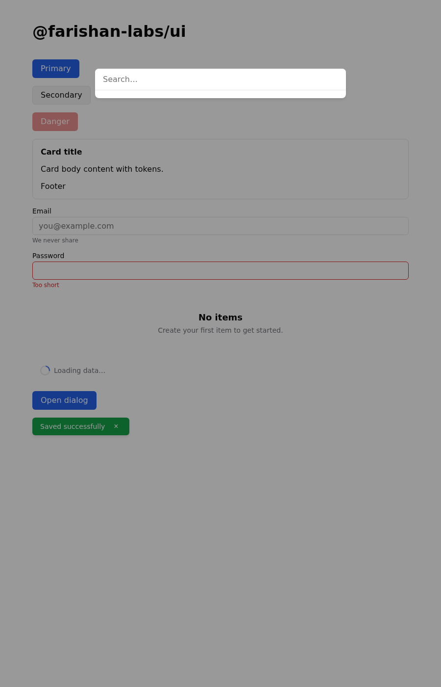

# @farishan-labs/ui

Headless UI primitives + W3C DTCG tokens for Faris Han Labs. Web components
(first), a11y-first, framework-agnostic core. GPL-3.0.



## Status

v0.1 in progress. See `PHILOSOPHY.md` for the durable principles and
`AGENTS.md` for tooling.

## Install

```bash
bun add @farishan-labs/ui
# tokens are provided by @farishan-labs/design-tokens (pulled in as a dependency)
```

Or drop in the generated CSS:

```html
<link rel="stylesheet" href="node_modules/@farishan-labs/design-tokens/src/tokens/tokens.css" />
```

## Usage

```ts
import "@farishan-labs/ui"; // registers custom elements
import { tokens } from "@farishan-labs/ui"; // re-exported from design-tokens
```

```html
<ui-button variant="primary">Save</ui-button>
```

## Development

```bash
bun install
bun run check
bun test
```

## Research basis

`research/topics/farishan-labs-ui/` (README, findings E0001–E0080, gaps G1–G31,
needs N1–N11). Research gate satisfied 2026-11-09.
